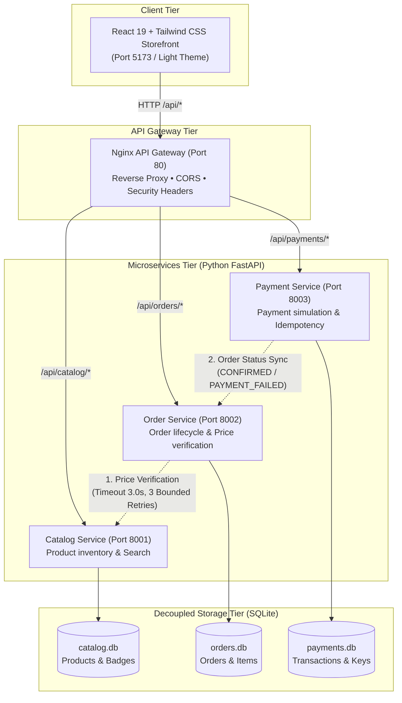

# Sagility Demo — Intelligent Commerce. Seamlessly Connected.

An editorial, high-end e-commerce experience inspired by Stripe and Linear, engineered with a decoupled cloud-native microservices architecture. Built from scratch for technical project evaluation.

---

## 🏛️ System Architecture



---

## 🌟 Visual Design & Theme System

Strictly built adhering to the specified **Light Theme Palette**:
- **Background**: `#F7F9FC`
- **Cards & Surfaces**: `#FFFFFF`
- **Primary Brand**: `#365CF5` (with subtle tints `#EEF2FF` / `#E4EAFF`)
- **Main Typography**: `#172033` (Plus Jakarta Sans)
- **Editorial Accent**: Instrument Serif italic typography
- **Secondary Text**: `#687386`
- **Borders**: `#E5EAF2`
- **Mint Accents**: `#C9F7DF` (Status pills & Confirmed badges)
- **Lavender Accents**: `#EAE5FF` (Idempotency badges & Highlights)

---

## 🚀 Key Cloud-Native Features

1. **Decoupled Databases**:
   - Each microservice owns its isolated SQLite database file (`catalog.db`, `orders.db`, `payments.db`) with zero cross-database queries.
2. **Trusted Price Calculation at Source**:
   - The frontend never submits trusted pricing. When an order is placed, the **Order Service** calls the **Catalog Service** via internal RPC to calculate subtotal, taxes (8.25%), and free shipping ($100+ threshold).
3. **Resilient Service-to-Service Communication**:
   - Inter-service calls use strict 3.0s timeouts and **bounded retries** (up to 3 attempts with exponential backoff).
4. **Strict Payment Idempotency**:
   - The Payment Service indexes unique `Idempotency-Key` tokens. Duplicate requests return cached responses with header `X-Cache-Lookup: HIT` and flag `is_idempotent_replay: true`, preventing double charges.
5. **Safe Fault Injection & Recovery**:
   - Interactive fault simulation endpoints (`/fault/inject` and `/fault/restore`) enable live demonstration of upstream failure handling and automatic recovery.
6. **Structured JSON Logging**:
   - Every request records timestamp, HTTP method, path, response status, and duration in milliseconds.

---

## 📂 Project Structure

```text
sagility-demo/
├── services/
│   ├── catalog/             # Catalog microservice (Port 8001)
│   │   ├── main.py          # FastAPI endpoints, seeds, fault injection
│   │   ├── models.py        # SQLAlchemy & Pydantic models
│   │   ├── database.py      # SQLite connection & session
│   │   ├── requirements.txt # Catalog dependencies
│   │   └── Dockerfile       # Container definition & healthcheck
│   ├── order/               # Order microservice (Port 8002)
│   │   ├── main.py          # Order creation, trusted price RPC
│   │   ├── models.py        # Order & OrderItem models
│   │   ├── database.py      # SQLite orders.db
│   │   ├── requirements.txt # Order dependencies
│   │   └── Dockerfile
│   └── payment/             # Payment microservice (Port 8003)
│       ├── main.py          # Idempotency cache, status sync
│       ├── models.py        # Payment transaction models
│       ├── database.py      # SQLite payments.db
│       ├── requirements.txt # Payment dependencies
│       └── Dockerfile
├── gateway/
│   └── nginx.conf           # Single API Gateway entrypoint & routing
├── frontend/                # React 19 + TypeScript + Tailwind CSS
│   ├── src/
│   │   ├── components/      # Navbar, Hero, ProductCard, CartDrawer,
│   │   │                    # CheckoutModal, OrderHistoryView, ArchitectureView
│   │   ├── services/api.ts  # Gateway API client & live event bus
│   │   ├── types/index.ts   # Shared TypeScript definitions
│   │   └── App.tsx          # Main application orchestrator
│   └── package.json
├── tests/
│   └── test_microservices.py # Comprehensive automated test suite
├── docker-compose.yml       # Production container orchestration
├── run_local.py             # One-click multi-service runner
├── start-all.ps1            # PowerShell launcher
├── start-all.bat            # Windows batch launcher
├── .env.example             # Environment template
└── README.md
```

---

## ⚡ Quickstart & Five-Minute Evaluation Demo

### Option A: Local Runner (Instant)

1. **Launch all services**:
   ```powershell
   python run_local.py
   # or run .\start-all.ps1
   ```
2. **Access the application**:
   - **Storefront & Topology**: [http://127.0.0.1:5173](http://127.0.0.1:5173)
   - **Catalog Swagger**: [http://127.0.0.1:8001/docs](http://127.0.0.1:8001/docs)
   - **Order Swagger**: [http://127.0.0.1:8002/docs](http://127.0.0.1:8002/docs)
   - **Payment Swagger**: [http://127.0.0.1:8003/docs](http://127.0.0.1:8003/docs)

### Option B: Docker Compose

```bash
docker-compose up --build
```
- Gateway available at `http://localhost/`
- Microservices routed via `/api/catalog/`, `/api/orders/`, `/api/payments/`.

---

## 🎯 5-Minute Evaluation Walkthrough

1. **Storefront & Catalog Browsing**:
   - Open [http://127.0.0.1:5173](http://127.0.0.1:5173).
   - Notice the editorial hero with headline: *"Commerce, built to work together."*
   - Filter by categories (*Hardware, Audio, Desk Accessories, Lighting*) and test real-time search.
2. **Add to Cart & Drawer**:
   - Click **Add to Cart** on items (e.g. *Aura Mechanical Keyboard*).
   - Open the **Cart Drawer** at top-right; adjust quantities and observe subtotal, tax (8.25%), and free shipping calculations.
3. **Multi-Service Checkout & Order Orchestration**:
   - Click **Proceed to Checkout**.
   - Review pre-filled customer details and generated `Idempotency-Key`.
   - Click **Authorize & Place Order**: watch the 4-step orchestration visualizer execute:
     - `Order Service (8002)` creates order record (`PENDING`).
     - `Order Service` verifies prices at `Catalog Service (8001)`.
     - `Payment Service (8003)` authorizes mock transaction.
     - Order status transitions to `CONFIRMED`.
4. **Payment Idempotency Verification**:
   - In the result modal, click **Re-send Same Key**.
   - Notice `IDEMPOTENT CACHE HIT` and `X-Cache-Lookup: HIT` — transaction is not charged twice!
5. **Payment Failure Simulation**:
   - Check **Simulate Payment Failure State** and submit.
   - The order safely transitions to `PAYMENT_FAILED` with simulated decline details.
6. **Live Architecture Topology & Safe Fault Recovery**:
   - Click **Architecture & Topology** in the top navigation.
   - Inspect live SVG wiring and health stats across all 3 services.
   - Click **Inject Fault into Catalog** (simulates 500 degradation). Notice the status changes to Degraded and downstream retry events appear in the live audit feed.
   - Click **Restore Catalog Service** to return to 100% operational health.
7. **Order Ledger**:
   - Switch to **Orders** tab to inspect all persisted orders in `orders.db` with status badges and item breakdowns.

---

## 🧪 Automated Test Suite

Run the end-to-end integration tests:
```bash
python tests/test_microservices.py
```
**Test Results:**
- `Catalog Service Health & Seeding` → **PASS**
- `Safe Fault Injection & Recovery` → **PASS**
- `Order Service Creation & Trusted Price RPC` → **PASS**
- `Payment Processing & Order Synchronization` → **PASS**
- `Payment Idempotency Replay (X-Cache-Lookup: HIT)` → **PASS**
- `Payment Failure Simulation & Status Sync` → **PASS**
